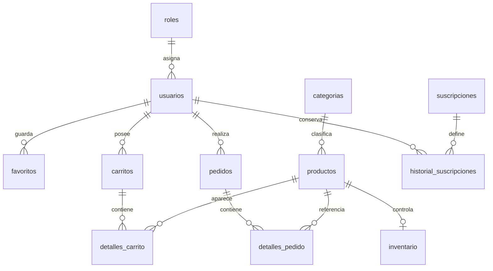

# Modelo relacional de OtakuZone — Fase 5

Diseñado tras revisar las rutas, los servicios, los DTO del catálogo y `mock/db.json`. El API actual expone productos/categorías/promociones con identificadores slug; el frontend conserva favoritos y perfil locales, y Jikan sigue siendo externo. No se añaden endpoints públicos de escritura ni autenticación en esta fase.

## Entidades y normalización

- **roles / usuarios:** cada usuario tiene un rol; no se crea una tabla puente para una multiplicidad que la aplicación no necesita. Correo único, nombre y presentación; hash opcional reservado para otra fase. No se crean usuarios ni hashes predeterminados en las semillas.
- **categorias / productos:** relación 1:N coherente con el contrato actual. IDs slug estables para no romper URLs ni DTO; precio DECIMAL(10,2), sin copiar categorías en cada fila. Baja lógica para conservar referencias comerciales.
- **inventario:** como máximo una fila por producto, con cantidades enteras total/reservada y disponible calculada. La FK por sí sola no obliga a que todo producto tenga inventario: esa invariancia se cumple al crear ambas filas en una transacción y en las semillas. No se guarda un segundo stock dentro de productos.
- **favoritos:** PK compuesta usuario + identificador positivo de Jikan. No existe tabla anime local ni copias de sinopsis, géneros, episodios o portadas. No se importan obras demo como referencias reales. La existencia del ID externo no puede validarse con una FK MySQL.
- **carritos / detalles_carrito:** cabecera por usuario y líneas únicas por producto; un índice único sobre columna generada permite como máximo un carrito activo por usuario. El carrito no congela precios: se consultan al preparar una compra futura.
- **pedidos / detalles_pedido:** cabecera, moneda PEN y envío; líneas con cantidad, nombre y precio unitario históricos. Los snapshots históricos son deliberados y no se actualizan al cambiar el catálogo. Subtotal de línea generado; el total del pedido se obtiene agregando líneas y envío, no se mantiene una suma independiente susceptible de divergir.
- **suscripciones:** catálogo de planes Free/Premium. **historial_suscripciones:** periodos de cada usuario y precio contratado como snapshot. Un índice único generado limita a un periodo activo por usuario. No se duplica una tabla de "suscripción actual": se deriva del historial activo. La ausencia de solapamientos de todos los periodos históricos exige lógica transaccional futura; no se promete resolverla con un CHECK entre filas.
- **promociones:** entidad adicional requerida por el endpoint ya consumido en Home. No necesita una relación artificial con categorías o usuarios.
- **schema_migrations:** metadatos técnicos de versiones/checksums, sin función comercial.

## Integridad

MySQL 8.0.16 o posterior, InnoDB, utf8mb4. PK/FK del mismo tipo y collation. Importes DECIMAL; cantidades enteras. CHECK para valores no negativos, cantidades positivas, reserva <= total, booleanos y fechas ordenadas. Claves únicas para correo, códigos de rol/plan y líneas/favoritos. Índices de FK y de consultas por usuario/estado/fecha/categoría; no se duplican índices ya cubiertos por el prefijo de una PK/índice compuesto.

El borrado de usuario elimina sus favoritos; sus carritos deben eliminarse explícitamente antes (sus líneas se eliminan con la cabecera). La FK de carritos usa RESTRICT porque usuario_id es base de una columna generada almacenada, para la que MySQL restringe acciones referenciales. Los pedidos y el historial de suscripciones también impiden eliminar usuarios con historial comercial. Productos/categorías/planes con referencias quedan protegidos por RESTRICT; los pedidos y sus líneas no se borran automáticamente. La administración debe usar bajas lógicas y operaciones controladas.

Los catálogos y precios iniciales son demostrativos. No hay cuentas activas, credenciales, pedidos reales ni cobros en las semillas. Se preserva el contrato JSON actual; DECIMAL se convierte a número solo en el DTO de precios del catálogo por compatibilidad con la UI, no para calcular operaciones monetarias en JavaScript.
